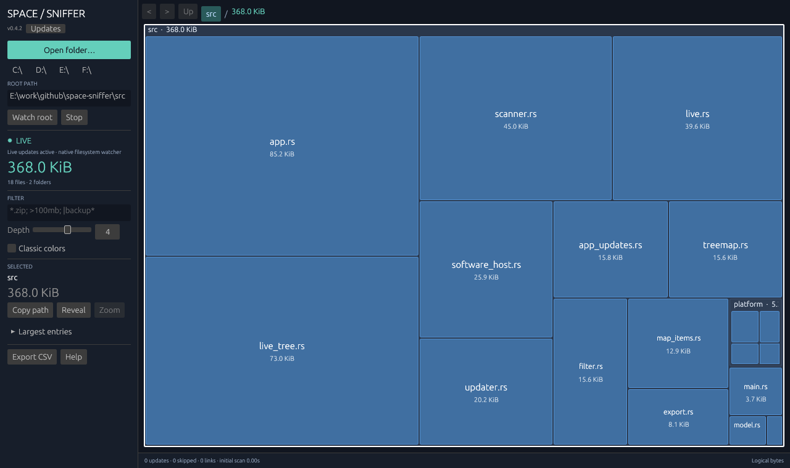

# Space Sniffer

**FREE and open source for Windows.** No license fee. Released under the [MIT license](LICENSE).

A native, live disk usage explorer written in Rust with [eframe / egui](https://github.com/emilk/egui). Choose any drive, folder, or accessible network path: the treemap starts filling during the initial scan, then updates automatically as files change. A compact left sidebar keeps controls and selection details beside the map.

[Download Windows .exe](https://github.com/siarheisinelnikau/space-sniffer/releases/latest/download/space-sniffer.exe) · [Latest release](https://github.com/siarheisinelnikau/space-sniffer/releases/latest) · [Performance notes](docs/performance.md)



The app watching a real project folder on Windows.

This is an independent implementation inspired by [SpaceSniffer by Uderzo Software](https://www.uderzo.it/main_products/space_sniffer/). It is not affiliated with Uderzo Software and does not use the original application's source code or assets.

## What works

- Parallel background scanning with progress and cancellation, using up to eight directory workers.
- A growing, interactive map during the first scan, without waiting for the whole drive to finish.
- Automatic filesystem watching, incremental file updates, and recovery after missed events.
- A squarified treemap with nested folders, file type colors, adjustable depth, and a Classic palette.
- Folder zoom, breadcrumbs, back/forward navigation, and a selection inspector with the largest child entries.
- Filename and size filters, path copying, and opening an entry in the system file manager.
- CSV export of the current subtree, with original and filtered byte counts.
- Drive shortcuts, a root path field, and an empty start screen until you choose a location.
- A command-line scan summary without opening a window.

Large-tree work is measured separately from disk I/O: million-entry filtering runs in short UI slices, and the map aggregates small files instead of drawing millions of rectangles. A dense 8,000-tile CPU frame benchmark improved from roughly **18 ms to 5 ms**. See [benchmarks, methodology, and limits](docs/performance.md); these are local CPU measurements, not whole-drive or frame-rate guarantees.

Scanning reads filesystem metadata. The app has no file deletion feature or telemetry. Export writes only the report you choose to save.

**Platform status:** Windows is the supported desktop platform and the only official binary download. Linux and macOS have automated build/test checks, but their desktop behavior has not been verified by the maintainer. Experimental macOS porting work lives in the [`macos` branch](https://github.com/siarheisinelnikau/space-sniffer/tree/macos).

## Build and run

Install [Rust](https://www.rust-lang.org/tools/install) **1.88 or newer** with Cargo. The repository includes `Cargo.lock`; use `--locked` for reproducible dependency selection.

### Windows

Use the MSVC Rust toolchain, plus Visual Studio Build Tools with **Desktop development with C++** and a Windows SDK. The [Rust Windows setup guide](https://rust-lang.github.io/rustup/installation/windows.html) describes the prerequisites.

From the repository directory in PowerShell:

```powershell
cargo run --locked --release
cargo run --locked --release -- "C:\Users"
cargo run --locked --release -- --scan "C:\Users"
```

The first command opens the root chooser. The second opens the app, scans that path, and watches for changes. `--scan PATH` prints totals and up to 20 of the root's largest children without opening a window or starting a watcher. A regular file is also a valid scan root.

To build the executable without launching it:

```powershell
cargo build --locked --release
.\target\release\space-sniffer.exe
```

### Linux

For Debian/Ubuntu, install a C/C++ toolchain and the graphics development packages used by eframe's X11/Wayland backends:

```sh
sudo apt-get update
sudo apt-get install -y build-essential pkg-config libx11-dev \
  libxcb-render0-dev libxcb-shape0-dev libxcb-xfixes0-dev \
  libxkbcommon-dev libxkbcommon-x11-dev libwayland-dev \
  libgl1-mesa-dev libegl1-mesa-dev libssl-dev
cargo run --locked --release -- "$HOME"
```

See the [eframe Linux prerequisites](https://docs.rs/crate/eframe/0.33.0). Running the GUI requires a graphical desktop and working OpenGL drivers. File dialogs use rfd's default [XDG Desktop Portal backend](https://docs.rs/rfd/0.15.4/rfd/#linux--bsd-backends), which needs `xdg-desktop-portal` and a backend for your desktop, such as `xdg-desktop-portal-gtk` or `xdg-desktop-portal-kde`. GTK development headers are not required by this app's default dialog backend.

### macOS

macOS support is experimental. Use the dedicated [`macos` branch](https://github.com/siarheisinelnikau/space-sniffer/tree/macos) and its [porting guide](https://github.com/siarheisinelnikau/space-sniffer/blob/macos/docs/macos.md). The maintainer has no Mac available for manual GUI testing; a successful CI build does not establish desktop compatibility.

Install Rust and Xcode Command Line Tools (`xcode-select --install`), then run from that branch:

```sh
cargo run --locked --release -- "$HOME"
```

Download and run the standalone **space-sniffer.exe** from [GitHub Releases](https://github.com/siarheisinelnikau/space-sniffer/releases/latest). It needs no installation or extraction. Releases contain only the Windows x86-64 executable; Linux and macOS can be built from source. The latest release is kept; older release entries and their assets are removed after a successful upload, while Git tags and commit history remain available.

## Explore a scan

Choose a drive shortcut or **Open folder**, enter any accessible path and press **Watch root** or Enter, or pass a path on the command line. No location is scanned until you choose one. The root appears first and the map grows as entries arrive, so you can inspect, zoom, and filter during the scan. Subsequent file creation, writes, renames, and deletion update the completed map automatically.

During scanning, **Discovered so far** counts only data already shown on the map. It can lag the scanner while the interface is busy; it is not a final disk total. The sidebar group is **Discovered entries**, in discovery order. Completion automatically replaces this preview with the full sorted result, retaining the filter and restoring selection/zoom where their paths still exist.

**Stop** cancels scanning or watching and keeps the current map. A stopped initial scan remains explicitly marked **Partial map**. **Export CSV** becomes available after the initial scan completes, so a preview cannot be mistaken for a full report. Restart the root or use an optional full rescan to finish a stopped scan.

The left sidebar contains root selection, watcher status, filters, depth, colors, selection details, and export. **LIVE** indicates an active native watcher; status messages explain recovery or fallback behavior. The map is cached between relevant changes, and an idle watcher does not continuously redraw the window.

Large filters show **Filtering** progress while the previous filter stays visible. File events wait in a bounded queue until the result is installed; filesystem scanning continues. Small entries are grouped into a tile showing their combined bytes and count. Zoom or filter to inspect them.

| Control | Action |
| --- | --- |
| Click a tile or list entry | Inspect it |
| Double-click a folder | Zoom into it |
| Breadcrumbs, back/forward arrows | Navigate the scan |
| `Ctrl+O` | Choose a folder |
| `F5` | Optional full rescan of the root path |
| `Backspace` | Go to the parent folder when not editing text |
| **Depth** | Show 1–6 nested levels |
| **Classic** | Switch the treemap palette |
| **Copy path** / **Reveal** | Copy the selection's path / open the system file manager |

Zero-byte entries are available in the list but have no treemap area. During scanning, the inspector lists up to 100 discovered children; after completion it lists up to 100 of the largest children.

## Filters

Filters apply to file basenames, ignoring case. Plain text matches a substring; patterns containing `*` or `?` match the whole name. `*` matches any number of characters and `?` matches one character. Join clauses with `;` to require all of them. Prefix a name pattern with `|` to exclude it.

| Query | Meaning |
| --- | --- |
| `report` | Names containing `report` |
| `*.zip` | Names ending in `.zip` |
| `photo?.jpg` | Names such as `photo1.jpg` |
| `\|backup*` | Exclude names beginning with `backup` |
| `>100MB` | Files strictly larger than 100,000,000 bytes |
| `<2GiB` | Files strictly smaller than 2,147,483,648 bytes |
| `*.zip; >100MB; \|backup*` | ZIP files over 100 MB, excluding names beginning with `backup` |

`KB`, `MB`, `GB`, `TB`, `PB`, and `EB` use powers of 1000. `KiB`, `MiB`, `GiB`, `TiB`, `PiB`, and `EiB` use powers of 1024. Bare numbers mean bytes; decimal quantities such as `>1.5MiB` must resolve to whole bytes. Filters do not include date or tag syntax. An invalid query displays an error and leaves the previous valid filter active.

**Export CSV** saves every entry in the currently zoomed subtree, including entries hidden by a filter and zero-byte entries. Columns are `path`, `kind`, `bytes`, and `visible_bytes`. Directory rows contain aggregate sizes, so summing every row would count descendants repeatedly. CSV paths are escaped and protected against spreadsheet formula interpretation.

## Size semantics and current limits

- Sizes are logical file lengths, not allocated disk space. Compression, sparse files, filesystem metadata, and free space are not measured.
- Hard links count separately for every path; their shared storage is not deduplicated.
- Symbolic links and Windows reparse points, including junctions, are not traversed and contribute zero bytes. Selecting a link as the scan root produces an error.
- Unreadable or disappearing descendants are skipped and counted. An unreadable root produces an error. A scan can therefore be partial; it does not bypass permissions.
- Initial scans use bounded parallel directory traversal, with up to eight workers. Windows reuses metadata returned by directory enumeration. Storage and tree shape affect performance; parallel access can be slower on a hard drive.
- Watching is event driven. Unsupported filesystems, network shares, permissions, and event overflow can affect notification delivery. If native watching fails, the sidebar reports fallback mode: full snapshots are checked every two seconds, with native watching retried every five seconds. This fallback can cost more on large roots. A scan is not an atomic filesystem snapshot.
- The full scan is held in memory. Very large trees can take time to scan, filter, and draw. Cancellation is cooperative and cannot interrupt an operating system call already in progress.

## Contributing and license

Pull requests are welcome. See [CONTRIBUTING.md](CONTRIBUTING.md) for checks and manual verification, [docs/architecture.md](docs/architecture.md) for the module layout, and [docs/performance.md](docs/performance.md) for scanner benchmarks.

```sh
cargo fmt --all -- --check
cargo clippy --locked --all-targets -- -D warnings
cargo test --locked --all-targets
cargo build --locked --release
```

Released under the [MIT license](LICENSE).

### Help bring Space Sniffer to macOS

Please base macOS-specific pull requests on the [`macos` branch](https://github.com/siarheisinelnikau/space-sniffer/tree/macos) and target `macos` when opening your PR. It contains the experimental port and its [build and testing guide](https://github.com/siarheisinelnikau/space-sniffer/blob/macos/docs/macos.md). The maintainer cannot manually test macOS, so contributions from Mac users are especially welcome: GUI testing, Finder integration, keyboard shortcuts, APFS and external-volume behavior, live updates, app bundles, and signing/notarization. Include your macOS version, Apple Silicon or Intel architecture, and what you actually tested. Shared improvements and Windows fixes should target `main`.
