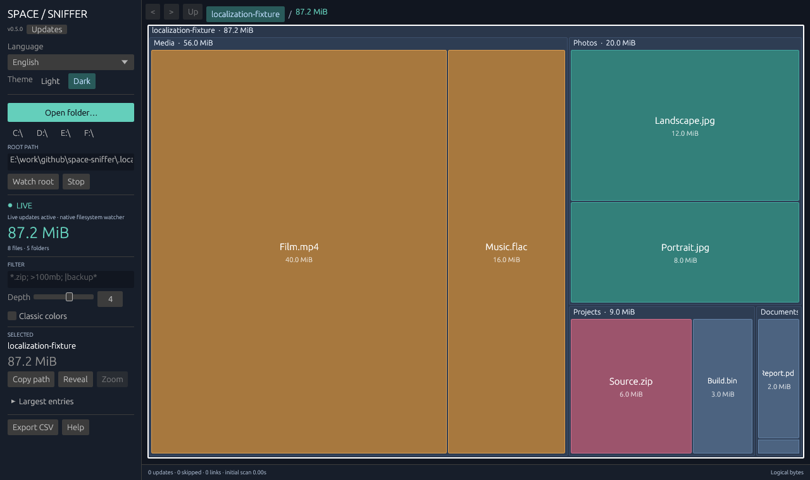
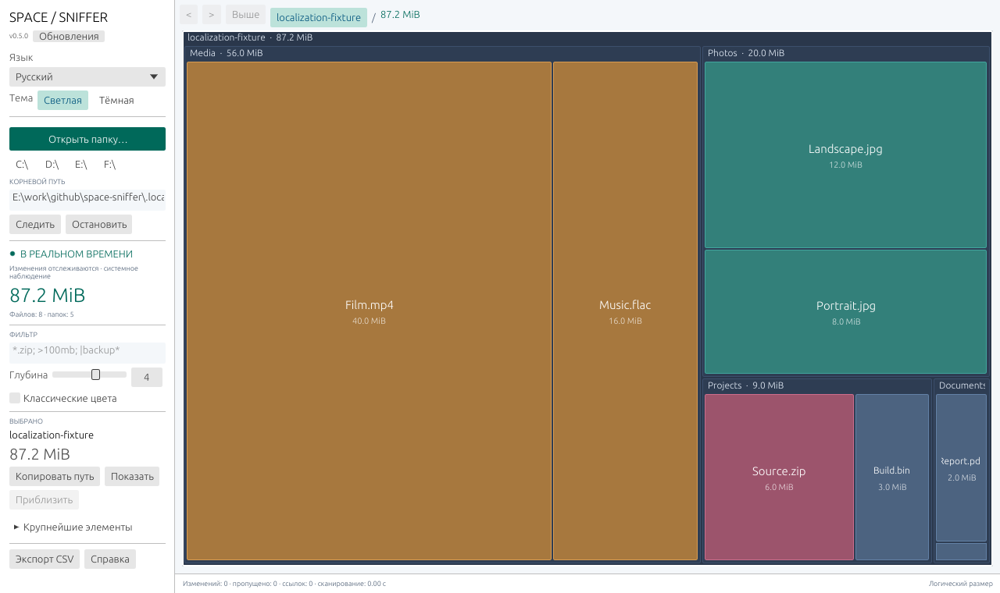
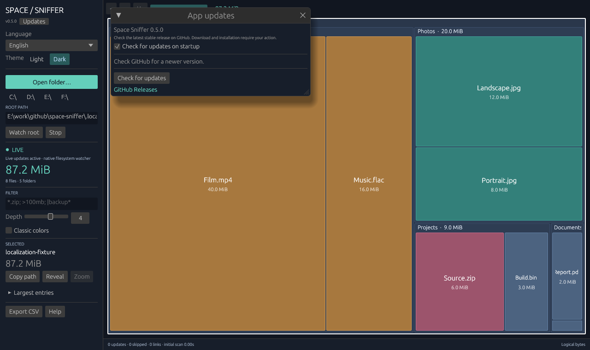
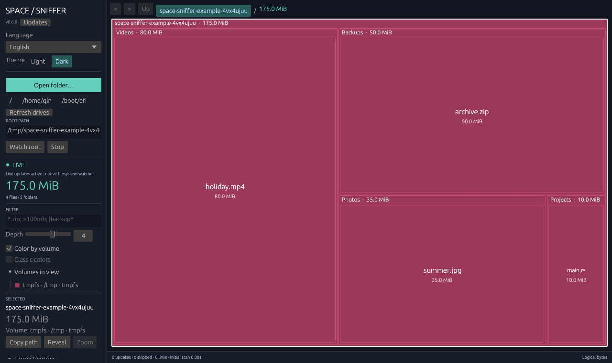

# Space Sniffer

**FREE and open source for Windows and Ubuntu.** No license fee. Released under the [MIT license](LICENSE).

A native, live disk usage explorer written in Rust with [egui](https://github.com/emilk/egui). One Cargo project shares the scanner, live model, filters, treemap, and interface across platforms. Windows renders the interface on the CPU and presents it through GDI, without creating an OpenGL or DirectX context. Choose any drive, folder, or accessible network path: the treemap starts filling during the initial scan, then updates automatically as files change. A compact left sidebar keeps controls and selection details beside the map.

[Download Windows .exe / Ubuntu .deb](https://github.com/siarheisinelnikau/space-sniffer/releases/latest) · [Ubuntu build and install](docs/ubuntu.md) · [Performance notes](docs/performance.md)



Space Sniffer 0.6.4 on Ubuntu, rendered by the application with an isolated sample folder. The key above the map identifies the three colors.

This is an independent implementation inspired by [SpaceSniffer by Uderzo Software](https://www.uderzo.it/main_products/space_sniffer/). It is not affiliated with Uderzo Software and does not use the original application's source code or assets.

The Windows executable now embeds the treemap application mark at 16, 20, 24, 32, 48, 64, 128 and 256px. Space Sniffer has no tray icon or background tray mode. `scripts/inspect-icons.ps1 -ExecutablePath target/release/space-sniffer.exe` verifies packaged resources and saves native light/dark proofs without starting the application.

## What works

- Parallel background scanning with progress and cancellation, using up to eight directory workers.
- A growing, interactive map during the first scan, without waiting for the whole drive to finish.
- Automatic filesystem watching, incremental file updates, and recovery after missed events.
- A squarified treemap with nested folders, three color categories, adjustable depth, and a Classic palette.
- Folder zoom, breadcrumbs, back/forward navigation, and a selection inspector with the largest child entries.
- Filename and size filters, path copying, and opening an entry in the system file manager.
- CSV export of the current subtree, with original and filtered byte counts.
- Drive shortcuts, including mounted Linux filesystems, a root path field, and an empty start screen until you choose a location.
- Optional volume colors, a map legend, and volume details in the inspector and tooltips.
- A command-line scan summary without opening a window.
- Background GitHub update checks, release notes, and verified in-app updates for Windows and Ubuntu x86-64.
- Live interface language switching between English, Russian, French, German, Spanish, and Italian.
- Persistent light and dark themes, with a direct switch in the sidebar.

Large-tree work is measured separately from disk I/O: million-entry filtering runs in short UI slices, and the map aggregates small files instead of drawing millions of rectangles. A dense 8,000-tile CPU frame benchmark improved from roughly **18 ms to 5 ms**. See [benchmarks, methodology, and limits](docs/performance.md); these are local CPU measurements, not whole-drive or frame-rate guarantees.

Scanning reads filesystem metadata. The app has no file deletion feature or telemetry. Export writes the report you choose to save. Update checks contact GitHub; downloading and replacing the application require your action.

**Platform status:** Windows and Ubuntu use the same application and codebase. Ubuntu has mount discovery, a desktop launcher, `.deb` packaging, and X11 GUI smoke checks; see the [Ubuntu guide](docs/ubuntu.md) for prerequisites and verification limits. Releases include a Windows executable and an Ubuntu amd64 package built on Ubuntu 22.04. macOS remains experimental.

## Build and run

Install [Rust](https://www.rust-lang.org/tools/install) **1.95 or newer** with Cargo. The repository includes `Cargo.lock`; use `--locked` for reproducible dependency selection. Keep the shared `rust-auto-updator` repository beside this checkout: Cargo resolves `../rust-auto-updator/crates/rust-auto-updator`. CI and release runners provision the pinned source revision with `scripts/provision-shared-updater.ps1`; see the [Ubuntu guide](docs/ubuntu.md) for the equivalent local checkout.

### Windows

Use the MSVC Rust toolchain, plus Visual Studio Build Tools with **Desktop development with C++** and a Windows SDK. The [Rust Windows setup guide](https://rust-lang.github.io/rustup/installation/windows.html) describes the prerequisites.

From the repository directory in PowerShell:

```powershell
cargo run --locked --release
cargo run --locked --release -- "C:\Users"
cargo run --locked --release -- --scan "C:\Users"
```

The first command opens the root chooser. The second opens the app, scans that path, and watches for changes. `--scan PATH` prints totals and up to 20 of the root's largest children without opening a window or starting a watcher. A regular file is also a valid scan root.

To build the executable without launching it:

```powershell
cargo build --locked --release
.\target\release\space-sniffer.exe
```

### Ubuntu / Linux

See the [Ubuntu guide](docs/ubuntu.md) for installing a `.deb`, desktop integration, volume colors, and reproducible GUI checks.

For Debian/Ubuntu, install a C/C++ toolchain and the graphics development packages used by eframe's X11/Wayland backends:

```sh
sudo apt-get update
sudo apt-get install -y build-essential pkg-config libx11-dev \
  libxcb-render0-dev libxcb-shape0-dev libxcb-xfixes0-dev \
  libxkbcommon-dev libxkbcommon-x11-dev libwayland-dev \
  libgl1-mesa-dev libegl1-mesa-dev libssl-dev
cargo run --locked --release -- "$HOME"
```

See the [eframe Linux prerequisites](https://docs.rs/crate/eframe/0.33.0). Running the GUI requires a graphical desktop and working OpenGL drivers. File dialogs use rfd's default [XDG Desktop Portal backend](https://docs.rs/rfd/0.15.4/rfd/#linux--bsd-backends), which needs `xdg-desktop-portal` and a backend for your desktop, such as `xdg-desktop-portal-gtk` or `xdg-desktop-portal-kde`. GTK development headers are not required by this app's default dialog backend.

### macOS

Build macOS from `main`, using the same Rust application and core as Windows and Linux. See the [macOS guide](docs/macos.md) for Apple Silicon/Intel `.app` packaging and testing details. macOS support is experimental; a successful CI build does not establish desktop compatibility.

Install Rust and Xcode Command Line Tools (`xcode-select --install`), then run from the repository directory:

```sh
cargo run --locked --release -- "$HOME"
```

Download and run the standalone Windows executable from [GitHub Releases](https://github.com/siarheisinelnikau/space-sniffer/releases/latest). New releases use **SpaceSniffer-vVERSION-windows-amd64.exe**, such as `SpaceSniffer-v0.6.1-windows-amd64.exe`. The file needs no installation or extraction. For Ubuntu x86-64, download **SpaceSniffer-vVERSION-ubuntu-amd64.deb** and install it with `sudo apt install ./SpaceSniffer-v0.6.1-ubuntu-amd64.deb`. This adds the application-menu launcher. Packages are built on Ubuntu 22.04; macOS remains a source build. Publishing retains existing releases and assets. See the [release naming and publishing rules](CONTRIBUTING.md#releases).

## Language and appearance

Use **Language** at the top of the sidebar to choose **English**, **Русский**, **Français**, **Deutsch**, **Español**, or **Italiano**. The interface changes immediately, including the scan controls, progress and watcher messages, selection actions, filters, help, and update settings. English is the default language and the fallback for unknown messages. Filenames, paths, filter syntax, release notes supplied by GitHub, and technical operating-system details retain their original text.

Choose **Light** or **Dark** beside **Theme** to change the interface immediately. Both preferences are saved with the existing per-user settings and survive restarting or updating the portable executable. Existing installations keep the dark appearance until another theme is selected. Language and theme changes do not start a scan, contact a server, or introduce a recurring redraw timer.



The same application components and CPU/GDI renderer produce both themes. This is an application-generated client-area capture, not a desktop automation screenshot.

## App updates

The GUI checks the latest stable GitHub release once at startup, without blocking scanning or the interface. Click **Updates** beside the installed version in the sidebar, then **Check for updates** to check manually. This window also contains release notes, the release-page link, and the **Check for updates on startup** setting. Startup checking is enabled by default; turning it off saves the preference between launches and prevents startup update requests. Manual checking remains available. **Update available** appears in the sidebar when GitHub has a newer version. Command-line scans do not check for updates. Network failures and GitHub request limits appear in the updates window and can be retried; startup checks do not open result or error dialogs.

On Windows x86-64, choose **Download and install**. The download runs in the background, shows progress, and can be cancelled. The shared updater checks the exact size, SHA256SUMS manifest when supplied, GitHub's SHA-256 digest when supplied, and the Windows executable structure before offering **Install and restart**. Installation hands off to the verified new executable as a helper. It waits for this process to exit, replaces the executable at its existing path with a backup, then restarts the app and scans the current root again. The startup-check setting is stored per user and survives executable replacement; scanned files are not changed. Keep the executable in a folder you can write to; no administrator prompt is used. If preparing the helper fails, the app keeps running and shows an error. If launching the replacement fails, the helper restores the previous executable.

On Ubuntu x86-64, install the `.deb` once, then use the same **Download and install** and **Install and restart** controls. The updater checks the package size, SHA-256, package name, version and architecture. Ubuntu requests administrator authorization through polkit, and apt installs the package while the interface stays responsive. Cancelled authorization or a failed installation leaves the current window open with an error. After success the app restarts as your normal user and scans the previous root. Source builds and copied executables must first be installed from the `.deb`; package recovery is managed by apt/dpkg.

An interrupted download or checksum mismatch leaves the installed application unchanged. Temporary downloads are removed when discarded or the app closes. Releases without a SHA-256 digest or the expected platform asset can be opened on GitHub for manual updating. macOS and other architectures support release checks and the release-page link.

Release discovery, download verification and replacement are provided by the shared `rust-auto-updator` core. The updater is built into the application; no separate updater installation is required. Windows keeps a recovery copy in a private `.space-sniffer-update-*` folder beside the app and cleans it after the new native host presents its first frame; it accepts both versioned assets and the legacy `space-sniffer.exe` name. Ubuntu stages its verified `.deb` and restart helper in a private temporary directory, then cleans that directory after restart. The shared core is MIT licensed; its notice is included in `licenses/rust-auto-updator.txt`.

New updaters prefer filenames containing both platform and architecture, then try matching architecture aliases with or without a version/platform, followed by platform-only and historical names. Both `SpaceSniffer-x64.exe` and `SpaceSniffer-windows.exe` are recognized. The groups `amd64`/`x64`/`x86_64`, `i386`/`x86`/`i686`, and `arm64`/`aarch64` remain separate; the updater selects the architecture of the current build and verifies it inside the downloaded file. Exact matching prevents selecting another platform.

Starting after 0.6.1, each release uploads one Windows executable and one Ubuntu package. The updater verifies each download against the SHA-256 digest in GitHub's release metadata. [Space Sniffer 0.6.1](https://github.com/siarheisinelnikau/space-sniffer/releases/tag/v0.6.1) includes the old filenames for older updaters. If you are on 0.6.0 or earlier when a newer release is available, install 0.6.1 or the latest release manually once to resume automatic updates.



The Updates window in Space Sniffer 0.5.0 on Windows, including the persistent startup-check setting. Language and theme choices are in the sidebar and also apply to this window.

## Explore a scan

Choose a drive shortcut or **Open folder**, enter any accessible path and press **Watch root** or Enter, or pass a path on the command line. No location is scanned until you choose one. The root appears first and the map grows as entries arrive, so you can inspect, zoom, and filter during the scan. Subsequent file creation, writes, renames, and deletion update the completed map automatically.

During scanning, **Discovered so far** counts only data already shown on the map. It can lag the scanner while the interface is busy; it is not a final disk total. The sidebar group is **Discovered entries**, in discovery order. Completion automatically replaces this preview with the full sorted result, retaining the filter and restoring selection/zoom where their paths still exist.

**Stop** cancels scanning or watching and keeps the current map. A stopped initial scan remains explicitly marked **Partial map**. **Export CSV** becomes available after the initial scan completes, so a preview cannot be mistaken for a full report. Restart the root or use an optional full rescan to finish a stopped scan.

The left sidebar contains root selection, watcher status, filters, depth, colors, selection details, and export. **LIVE** indicates an active native watcher; status messages explain recovery or fallback behavior. The map is cached between relevant changes, and an idle watcher does not continuously redraw the window. Scan and update status indicators wait for actual results instead of continuously animating the map. On Windows, minimized windows continue processing background results without rebuilding or painting the interface; restore redraws the current data. Filesystem workers use Windows background resource scheduling so foreground input and applications take priority.

Large filters show **Filtering** progress while the previous filter stays visible. File events wait in a bounded queue until the result is installed; filesystem scanning continues. Small entries are grouped into a tile showing their combined bytes and count. Zoom or filter to inspect them.

| Control | Action |
| --- | --- |
| Click a tile or list entry | Inspect it |
| Double-click a folder | Zoom into it |
| Breadcrumbs, back/forward arrows | Navigate the scan |
| `Ctrl+O` / `Cmd+O` on macOS | Choose a folder |
| `F5` | Optional full rescan of the root path |
| `Backspace` | Go to the parent folder when not editing text |
| **Depth** | Show 1–6 nested levels |
| **Classic** | Switch the treemap palette |
| **Copy path** / **Reveal** | Copy the selection's path / open the system file manager |

The key above the map shows three colors. In the default palette, folders are dark blue, application files are purple, and other files are gray-blue. On Ubuntu and other Linux systems, the application category includes `.deb`, `.AppImage`, `.snap`, and `.flatpak` files. Windows highlights `.exe` files. **Classic** uses the same categories with different colors. With **Color by volume** enabled, use **Volumes in view** for the color key.

Zero-byte entries are available in the list but have no treemap area. During scanning, the inspector lists up to 100 discovered children; after completion it lists up to 100 of the largest children.

## Volume colors

Enable **Color by volume** to identify the filesystem containing each file. The choice persists across restarts; disabling it restores the existing file-type/Classic palette. **Volumes in view** shows the matching colors. The selected entry and hover tooltip show its volume even when coloring is disabled. **Refresh drives** rereads mount information after connecting or removing a drive; starting a scan also refreshes it. Use **F5** to refresh the file tree after mounting or unmounting inside a scanned root.

On Linux, the app reads `/proc/self/mountinfo`, uses the most specific mount point, and groups bind mounts of the same device under one color. It handles nested mounts, network mounts, and paths with spaces or non-UTF-8 bytes. Virtual filesystems remain identifiable but are omitted from the drive shortcuts. A folder spanning volumes and grouped small entries use a neutral color. The twelve-color palette repeats when more volumes are present; labels distinguish them.

A volume can be a partition, encrypted mapper, network share, or filesystem backed by several physical disks. These labels do not identify individual disks behind RAID/LVM. Windows uses drive roots and macOS uses `/` and `/Volumes` shortcuts; detailed Linux device discovery is isolated in its platform adapter.



A real Wayland capture of Sniffer 0.6.0 on Ubuntu with an isolated sample scan; the example files reside on one volume.

## Filters

Filters apply to file basenames, ignoring case. Plain text matches a substring; patterns containing `*` or `?` match the whole name. `*` matches any number of characters and `?` matches one character. Join clauses with `;` to require all of them. Prefix a name pattern with `|` to exclude it.

| Query | Meaning |
| --- | --- |
| `report` | Names containing `report` |
| `*.zip` | Names ending in `.zip` |
| `photo?.jpg` | Names such as `photo1.jpg` |
| `\|backup*` | Exclude names beginning with `backup` |
| `>100MB` | Files strictly larger than 100,000,000 bytes |
| `<2GiB` | Files strictly smaller than 2,147,483,648 bytes |
| `*.zip; >100MB; \|backup*` | ZIP files over 100 MB, excluding names beginning with `backup` |

`KB`, `MB`, `GB`, `TB`, `PB`, and `EB` use powers of 1000. `KiB`, `MiB`, `GiB`, `TiB`, `PiB`, and `EiB` use powers of 1024. Bare numbers mean bytes; decimal quantities such as `>1.5MiB` must resolve to whole bytes. Filters do not include date or tag syntax. An invalid query displays an error and leaves the previous valid filter active.

**Export CSV** saves every entry in the currently zoomed subtree, including entries hidden by a filter and zero-byte entries. Columns are `path`, `kind`, `bytes`, and `visible_bytes`. Directory rows contain aggregate sizes, so summing every row would count descendants repeatedly. CSV paths are escaped and protected against spreadsheet formula interpretation.

## Size semantics and current limits

- Sizes are logical file lengths, not allocated disk space. Compression, sparse files, filesystem metadata, and free space are not measured.
- Hard links count separately for every path; their shared storage is not deduplicated.
- Symbolic links and Windows reparse points, including junctions, are not traversed and contribute zero bytes. Selecting a link as the scan root produces an error.
- Linux scans omit kernel virtual filesystems, nested RAM/image/container mounts, and recursive bind aliases. Other mounted data disks remain included. Temporary filesystems and images can be scanned by selecting them directly; kernel interfaces such as `/proc` are rejected. See [Ubuntu mount behavior](docs/ubuntu.md#mounted-filesystems-and-colors).
- Excluded mounts and unreadable or disappearing descendants are skipped and counted. An unreadable root produces an error. A scan can therefore be partial; it does not bypass permissions.
- Initial scans use bounded parallel directory traversal, with up to eight workers. Windows reuses metadata returned by directory enumeration. Storage and tree shape affect performance; parallel access can be slower on a hard drive.
- Watching is event driven. Unsupported filesystems, network shares, permissions, and event overflow can affect notification delivery. If native watching fails, the sidebar reports fallback mode: full snapshots are checked every two seconds, with native watching retried every five seconds. This fallback can cost more on large roots. A scan is not an atomic filesystem snapshot.
- The full scan is held in memory. Very large trees can take time to scan, filter, and draw. Cancellation is cooperative and cannot interrupt an operating system call already in progress.

## Contributing and license

Pull requests are welcome. See [CONTRIBUTING.md](CONTRIBUTING.md) for checks and manual verification, [docs/architecture.md](docs/architecture.md) for the module layout, and [docs/performance.md](docs/performance.md) for scanner benchmarks.

```sh
cargo fmt --all -- --check
cargo clippy --locked --all-targets -- -D warnings
cargo test --locked --all-targets
cargo build --locked --release
```

Released under the [MIT license](LICENSE).

### Help bring Space Sniffer to macOS

The macOS build is experimental and still needs work. The maintainer has no Mac for testing, so we need your help [testing and improving it](docs/macos.md); please target `main` with your contributions.
