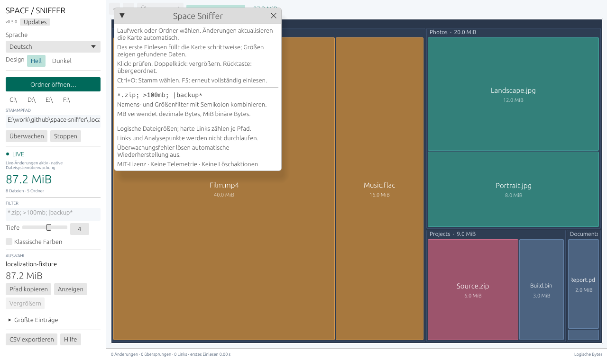

# Interface localization and themes

`src/i18n.rs` contains the complete English, Russian, French, German, Spanish, and Italian message catalog. Each message row has the English key followed by five translations. Keep source keys stable, translate every field, and preserve each numbered placeholder such as `{0}`. `Language::format` substitutes values after translation without interpreting braces in filenames or other inserted data.

UI labels are looked up explicitly. `Language::message` handles known engine status and error envelopes at the display boundary; raw filesystem names, paths, release notes, and OS diagnostic details are preserved. Engine messages stay in their base language so changing the interface language can update already displayed statuses. Filter syntax and CSV data formats remain stable across languages.

`Preferences` stores language and theme under the additive `interface-preferences` key in the existing per-user store. Missing preferences receive English/Dark defaults; unrelated keys, window geometry, and the startup update-check toggle remain intact. Theme palette roles supply panel, background, secondary text, accent and error colors; native egui visuals supply inputs, buttons, selection and popups. The treemap keeps its dark category tiles and light labels for readable file-type colors in either theme.

The sidebar changes preferences in response to input. Applying a different theme invalidates the interface once; language selection requests the fresh translated frame. Neither setting adds a polling timer or background work. Native Windows scheduling continues to use Wait/WaitUntil and retained bitmap presentation; hidden or minimized windows skip painting.

Catalog tests validate nonempty translations, duplicate keys, identical placeholder sets, safe value substitution, and preference migration/persistence. A UI regression renders all language/theme choices at the supported 800 × 520 minimum and checks that an unchanged window stops requesting frames.

For bounded real captures, build with `--features diagnostics,screenshots`, set `SPACE_SNIFFER_TEST_DATA` to a disposable settings directory and `EFRAME_SCREENSHOT_TO` to a fresh PNG destination, then run the executable with an isolated fixture folder. Optional settings are `SPACE_SNIFFER_SCREENSHOT_LANGUAGE=en|ru|fr|de|es|it`, `SPACE_SNIFFER_SCREENSHOT_THEME=light|dark`, and `SPACE_SNIFFER_SCREENSHOT_VIEW=main|updates|help`. The native Windows host validates these options before creating the window, suppresses startup update checks, renders two frames, saves its own framebuffer, and exits without persisting capture preferences. Always impose an external timeout and inspect the resulting PNG. This developer mode does not establish interactive input behavior or normal idle performance by itself.
