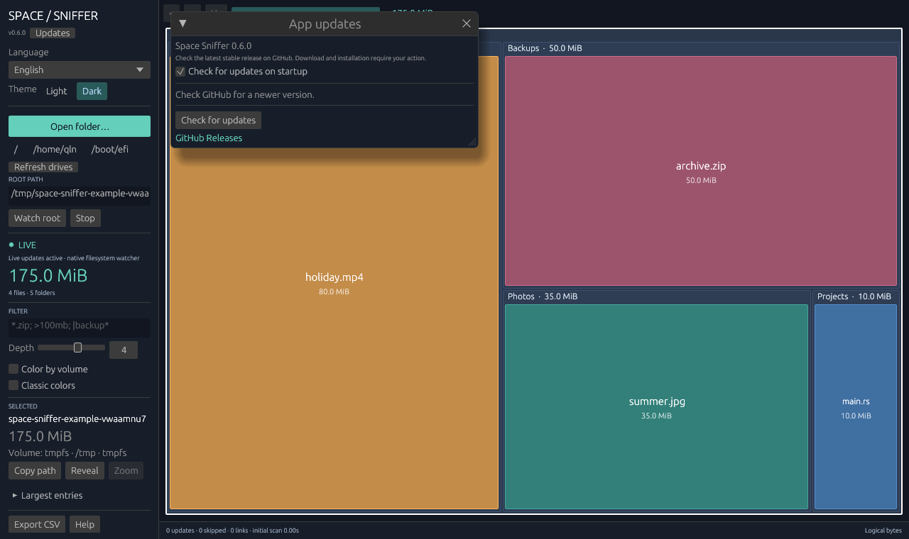

# Ubuntu

Ubuntu runs the same Rust application as Windows and macOS. The scanner, live
updates, filtering, export, navigation and interface are shared. Linux-specific
code discovers mounts and opens folders through `xdg-open`; eframe supplies the
X11/Wayland OpenGL window.

## Build

Use Rust 1.95 or newer. Install the build libraries once:

```sh
sudo apt-get update
sudo apt-get install -y build-essential pkg-config libx11-dev \
  libxcb-render0-dev libxcb-shape0-dev libxcb-xfixes0-dev \
  libxkbcommon-dev libxkbcommon-x11-dev libwayland-dev \
  libgl1-mesa-dev libegl1-mesa-dev libssl-dev \
  xdg-utils xdg-desktop-portal xdg-desktop-portal-gtk
```

On KDE use its portal backend instead of the GTK backend. The GUI needs a
graphical session and OpenGL. Portal dialogs run as your normal desktop user;
do not run the application with `sudo`.

The existing shared updater is a sibling path dependency. If it is not already
present, provision the same revision used by CI, from the directory containing
the `space-sniffer` checkout:

```sh
git clone https://github.com/siarheisinelnikau/rust-auto-updator.git
git -C rust-auto-updator checkout 78e10609c97b27bf1220855b9a573f348590b095
cd space-sniffer
cargo build --locked --release
./target/release/space-sniffer
./target/release/space-sniffer --scan "$HOME/Documents"
```

Preserve an existing sibling checkout instead of overwriting its changes.
The same `Cargo.toml` and `Cargo.lock` are used on every platform.

## Debian package and desktop launcher

Packaging requires Python 3.11+ and `dpkg-dev`. Ubuntu 22.04 users can use the
CI package or provide a newer Python; CI installs Python 3.13 explicitly.

```sh
python3 scripts/package_linux.py
sudo apt install ./target/debian/space-sniffer_0.6.0_amd64.deb
```

The script takes `--binary` and `--output` overrides, accepts amd64/arm64 Linux
ELF executables, and refuses to overwrite an existing package. It installs
`/usr/bin/space-sniffer`, an application-menu entry, the shared application mark
as an icon, and licenses. It has no privileged maintainer scripts. Only the
explicit `apt install` step changes the installed system. Remove it with
`sudo apt remove space-sniffer`.

Build on the oldest Ubuntu version you intend to support. Linked ABI dependencies
come from `dpkg-shlibdeps`, with extra dependencies for dynamically loaded
graphics backends. A package built on a newer Ubuntu may require newer libraries
and is not automatically compatible with 22.04. The CI matrix builds on both
22.04 and 24.04 and keeps each package in its own Actions artifact. The release
workflow publishes an amd64 `.deb` built on Ubuntu 22.04 together with the Windows
executable and a combined SHA256SUMS manifest.

Download the `.deb` from [GitHub Releases](https://github.com/siarheisinelnikau/space-sniffer/releases/latest) for the first installation. Later updates use **Updates → Check for updates → Download and install → Install and restart**. The shared updater verifies the size, SHA-256 and Debian package identity, then opens a polkit authorization prompt and installs through apt on a worker. The current app stays open on cancellation or error and restarts as the normal desktop user after success. Its previous scan root and saved preferences are retained. Source builds and copied executables must be installed through the package first. The package declares apt and polkit dependencies; recovery follows normal apt/dpkg behavior.

## Mounted filesystems and colors

Drive shortcuts include `/`, your home folder, and mounted data filesystems,
including USB storage and network shares. Virtual mounts such as `/proc`, `/sys`,
tmpfs, Snap images and container overlays are excluded from shortcuts.
Temporary storage and mounted images can still be selected explicitly.
Kernel interfaces such as `/proc` and `/sys` are rejected as scan roots. **Refresh drives** updates shortcuts and ownership after changing
mounts. It does not mount drives or rescan file contents. **F5** refreshes the
tree and mount snapshot together.

When scanning `/` or another broad root, both traversal and native watching
skip kernel interfaces, nested RAM filesystems, mounted Snap images, container
overlays, and bind mounts that lead back into already scanned storage. Other
data disks remain included. Excluded mount points count as skipped entries;
permissions and disappearing files can also contribute to that count. Ordinary
folders named `proc` or `sys` on a data disk are unaffected. The same policy
applies to previews and live subtree/root reconciliation. An unreadable directory
does not disable native watching for the rest of the disk.

This prevents `/proc/kcore` (a kernel memory image that can report roughly
128 TiB) from appearing as disk usage. Totals still describe accessible logical
file lengths, not `df`'s allocated blocks or total drive capacity. The traversal
policy uses a mount-table snapshot for the scan session; use **F5** after changing
mounts to rebuild the scan and watches.

Enable **Color by volume** to color files by their containing filesystem, with
a legend and volume labels in the inspector and hover tooltip. It defaults to
off and persists between launches. Turning it off restores file-type/Classic
colors. Windows and macOS use the same controls with their native root shortcuts.

Linux ownership comes from the current process's
[`/proc/self/mountinfo`](https://docs.kernel.org/filesystems/proc.html), using the
deepest matching mount. Device major/minor identity keeps bind aliases the same
color. Mount paths preserve raw filename bytes and decode mountinfo escapes.
Network and virtual filesystems have their own identities. Mount snapshots
reflect the app's mount namespace, including when running inside a container.

A directory can contain several volumes; such directory tiles are neutral.
Aggregated small entries are also neutral because they can contain multiple
volumes. The inspector describes the selected directory's own volume, not all
of its descendants. The twelve-color palette repeats beyond twelve identities;
read the label to distinguish them. Mounting/unmounting while scanning is not
an atomic snapshot: refresh the view afterward.

The label identifies a filesystem/volume, not necessarily a single physical
disk. Partitions, LVM, encrypted devices, RAID and network shares retain their
logical identity. File sizes and traversal semantics remain the shared scanner's
logical sizes; this feature does not measure allocated blocks or free space.

## Verification

```sh
cargo fmt --all -- --check
cargo clippy --locked --all-targets -- -D warnings
cargo test --locked --all-targets
cargo build --locked --release
python3 -m unittest discover -s scripts -p 'test_*.py'
desktop-file-validate packaging/linux/space-sniffer.desktop
```

For reproducible GUI captures, install `xvfb`, `xauth` and `desktop-file-utils`,
then run:

```sh
cargo build --locked --features screenshots
python3 scripts/smoke_linux.py
```

For the current Wayland desktop, add `--native-wayland --output target/wayland-smoke`; this briefly opens the same three windows and forces Wayland by removing `DISPLAY`.

This checks exact CLI totals and captures real empty, volume-colored, and Updates
windows using Xvfb/Mesa X11, a temporary sample tree and isolated settings. The viewport screenshot is captured before buffer swap and rejects a blank frame; this avoids the black images produced by eframe's legacy after-swap capture on some Wayland systems. The
normal binary has no screenshot controls. The CI jobs run these commands, build
and inspect the `.deb`, and retain the package and screenshots as artifacts.



Real Ubuntu X11 capture with isolated settings. Native Wayland interaction, portal file dialogs, removable-device
hotplug and actual package installation should also be checked on a desktop.
See [the local validation record](validation-ubuntu.md) for the checks actually
performed on this change; configured CI jobs are not evidence of a completed run.
