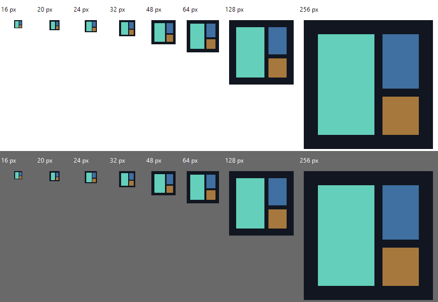

# Icon, updater and rendering audit — 2026-11-01

No computer-use APIs, desktop screenshots or input automation were used. The optimized Windows build enabled `diagnostics,screenshots` and used the sibling shared updater. Its SHA-256 is recorded in the adjacent icon and CPU reports.

- The Windows EXE now embeds the intended treemap artwork at 16, 20, 24, 32, 48, 64, 128 and 256 pixels. Native resource loading/drawing and alpha dimensions passed; the light/dark proof PNG was inspected. The runtime window icon and explicit taskbar ICON_BIG assignment use the same artwork. Space Sniffer intentionally has no tray. Explorer caching and physical mixed-DPI behavior remain unverified.
- Release discovery, download, cancellation, size/SHA/PE validation, staging and replacement now use `rust-auto-updator`. The local adapter preserves canonical and historical filenames, digest-only historical releases, saved startup opt-out, manual checks, progress and user-initiated install. The helper runs before GUI/CLI side effects, waits for the old process, replaces with a backup and restarts with the current scan root. Cleanup follows the first native presentation. Settings are saved by the normal host exit path.
- Retained OS expose events no longer present while hidden or minimized. The existing software rasterizer/GDI path and Wait/WaitUntil loop remain. In a bounded 24-second isolated run, the application itself minimized at eight seconds, restored at sixteen and closed at twenty-four. Settled UI/present counters stayed flat: 2/2 during initial visible idle, 4/2 while minimized (transition/logic passes only), 6/4 after restore. Each four-second CPU sample was below timer resolution on 20 logical CPUs. No OpenGL/D3D/DXGI modules were found. Transition paints were finite. This does not measure subjective interaction latency or compositor GPU behavior.
- A separate bounded own-framebuffer capture of Updates was inspected and saved as `docs/updates.png`. Diagnostic/capture modes avoid startup update requests and use isolated settings. Normal startup checks remain enabled by default.

Validation: formatter and all-target/all-feature Clippy pass; 25 GUI/host tests, two updater adapter tests and three macOS packaging tests pass. The complete library run passed 82/84: the two pre-existing hardlink/junction fixture tests were denied by the sandbox. An earlier slow run also hit timing-sensitive scanner assertions; those passed on the final parallel retry. A serial retry blocked in the existing synchronous live-unit output queue and its owned test process was stopped. No scanner implementation or fixture was changed. Three manual benchmark tests remain ignored. macOS/Linux runtime and the experimental macOS application icon were not verified here.

The shared updater raises the build requirement to Rust 1.95. Build/CI/release runners must provision the sibling source; no unpublished remote checkout URL is assumed. Its MIT notice is included, also in experimental macOS bundles. No release was published or altered.

